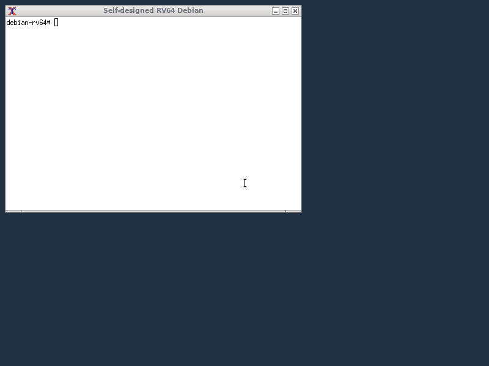

# GPT-built RV64 Linux SoC

[中文 README](README.md) · [Build](docs/build.md) · [Architecture](docs/architecture.md) · [Validation](docs/validation.md)

A project-specific RISC-V CPU in the **PL of an XC7Z020CLG484-2**, running OpenSBI, Linux and official Debian riscv64 programs through real PS DDR. An independent DDR display engine drives **800×600 HDMI at approximately 60 Hz**. The demonstrated minimal graphical environment uses Xorg, Openbox and xterm, with a USB keyboard and mouse through the PS USB controller and a hub.

The author directs the project, connects hardware and confirms visible/input results; GPT / Codex assists with RTL, software, build scripts and debugging. Floating-point arithmetic uses Berkeley HardFloat. Linux and Debian are upstream software. This is an independent personal project, not an official OpenAI or AMD product.



*Actual board DDR framebuffer readback, not a photograph of the monitor. The matching terminal window was separately confirmed on the connected monitor.*

## Current configuration

- 50 MHz system clock; M/S/U privilege, Sv39, atomics, compressed instructions, F/D and LP64D user software.
- I-Cache, write-back D-Cache, project AXI4 routing, PLIC, DMA maintenance and a noncached DMA pool.
- Vendor-IP-free portable RTL; Vivado board Tcl generates PS/AXI width and protocol adapters separately.
- JTAG-assisted loading of OpenSBI 1.6, Linux 6.6.80 and a minimal initramfs; official Debian 13 packages supply the graphical programs.
- ARM Cortex-A9 cores remain stopped during the demonstrated RISC-V/Linux execution.

The core retains a **ten-stage F0/F1/F2/F3 → D/I/X/M/N/C organization and dual-issue/prediction research logic**. However, the demonstrated GC board profile sets `ENABLE_C=1`, which currently disables paired issue, the predictor and early Load path. Do not attribute non-C research CoreMark/IPC numbers to this desktop configuration.

## Start here

```sh
git clone https://github.com/HanFrogKing/gpt-rv64-linux-soc.git
cd gpt-rv64-linux-soc
python3 tools/check_release.py
python3 tools/run_video_test.py
```

The native video test requires Verilator, a C++ compiler and make. FPGA implementation uses Vivado 2023.1; see the detailed [build guide](docs/build.md). The board scripts do not automatically program hardware or storage.

The public tree contains the selected board RTL, constraints, PS configuration, Vivado scripts, exact Linux project overlay, OpenSBI UART fix, board device tree, package hashes, desktop configuration and original software recipe references. Upstream archives and Debian packages are downloaded separately and checked against pinned hashes; no toolchain, proprietary IP implementation or system image is bundled.

The initial source publication still lacks a one-command reconstruction of the original diagnostic initramfs/desktop image and a fully portable JTAG loader. Reference recipes depend on historical stage artifacts. These gaps are documented rather than presented as a clean-room, one-click reproduction.

## Measured board result

R106 whole-board implementation: **32,827 LUT, 26,218 FF, 5 BRAM Tile, 14 DSP**; system/pixel/serializer clocks **50/40/200 MHz**; setup **+0.741 ns**, hold **+0.037 ns**. Existing CDC/BRAM/tool warnings remain documented; these numbers are not standalone CPU area or a claim of zero warnings.

## Limits and next work

The graphical environment is a minimal package-based setup, not a fully configured Debian installation. Startup is slow. There is no GPU/OpenGL acceleration, true VBlank or tear-free pageflip. Video signal refresh is independent of application render FPS. Native TF/SD autonomous cold boot is **not yet accepted**; the R118 candidate is not the stable hardware entry.

See [validation](docs/validation.md) for the separate historical physical results and checks rerun on this public tree, and [roadmap](docs/roadmap.md) for reproducible packaging, autonomous boot and GC performance work.

## License

Original project RTL, standalone tools and documentation use [MIT](LICENSE). Linux-derived code, OpenSBI and HardFloat keep their original licenses. See [THIRD_PARTY.md](THIRD_PARTY.md). AMD IP references require the appropriate local vendor tools/licenses; implementation products are not redistributed.
