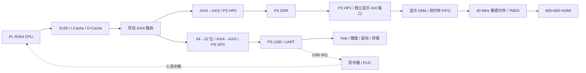

# GPT 从零手搓 CPU：RV64 Linux SoC

[English](README.en.md) · [硬件结构](docs/architecture.md) · [构建说明](docs/build.md) · [上板与启动](docs/bring-up.md) · [验证记录](docs/validation.md)

一颗运行在 **Zynq-7020 PL 中的 RISC-V CPU**，通过真实 PS DDR 启动 OpenSBI 和 Linux，执行官方 Debian riscv64 软件包，并通过 HDMI 显示 Xorg / Openbox / xterm。USB Hub 上的键盘、鼠标和存储设备由 PS USB 控制器接入。

项目由作者提出目标、连接硬件并确认实屏和输入结果，GPT / Codex 参与 RTL、软件、构建脚本和调试。CPU 核心采用本项目 RTL；浮点算术使用 Berkeley HardFloat，操作系统和桌面来自开源软件。**这不是一个所有组件均从零实现的 SoC，也不是在 ARM 上运行 Linux 再把画面转发出来。**


*图：从实板 DDR 读回的 800×600 帧缓冲，非显示器照片。对应显示器上的完整终端窗口，另有人工实屏确认。*

## 现在能做什么

| 项目 | 当前公开基线 |
|---|---|
| FPGA | RK-ZYNQ7020-F，**XC7Z020CLG484-2** |
| CPU / 总线 | 50 MHz；RV64、M/S/U、Sv39、A/C/F/D、LP64D 软件 |
| 内存系统 | I-Cache、写回 D-Cache、AXI4、DMA 缓存维护及非缓存池 |
| 启动 | JTAG 辅助装载；OpenSBI 1.6 → Linux 6.6.80 → 最小用户态 |
| 桌面 | Debian 13 riscv64 官方软件包；Xorg、Openbox、xterm，无合成器 |
| 显示 | 独立 DDR scanout，800×600，约 60 Hz HDMI |
| 输入 / 存储 | PS USB 2.0、Hub、键盘、鼠标、USB 存储只读访问 |
| 实测交互 | HDMI 终端执行 `echo hello`、`echo input_ok`，鼠标移动及窗口保持可见 |

**CPU 配置请特别留意：**源码具有 `F0/F1/F2/F3 → D/I/X/M/N/C` 十级组织，以及双发射和分支预测研究逻辑。但本次实板 Debian 配置启用了 `ENABLE_C=1`；当前实现会关闭双指令配对、预测器和提前 Load 路径，以保留压缩指令及浮点运行的正确性。不能把双发射研究版本的 CoreMark / IPC 成绩当作本次桌面配置的成绩。见[配置说明](docs/architecture.md#cpu-配置)。

## 整体结构



CPU 软件渲染与 HDMI 扫描相互独立：应用更新得慢时，显示控制器仍连续扫描。约 60 Hz 是视频信号刷新率，不是桌面应用的渲染帧率。

## 从哪里开始

```sh
git clone https://github.com/HanFrogKing/gpt-rv64-linux-soc.git
cd gpt-rv64-linux-soc
python3 tools/check_release.py
python3 tools/run_video_test.py       # 需要 Verilator、C++ 编译器和 make
```

FPGA 使用 **Vivado 2023.1**。在 Windows PowerShell 中，使用已加入 PATH 的 Vivado：

```powershell
$board = (Resolve-Path fpga/rk-zynq7020-f).Path
vivado -mode batch -source "$board/scripts/build.tcl" -tclargs "$board"
```

该命令运行综合、布局布线并输出报告，**不会自动连接板卡或烧写介质**。位流生成之前还需执行独立时序、CDC 和 BRAM 检查。完整命令及软件准备方法见[构建说明](docs/build.md)。

## 目录

```text
rtl/rv64/                  实板选中的 CPU、MMU、缓存、AXI、PLIC、显示 RTL
third_party/               HardFloat 的实际兼容版本及许可证
fpga/rk-zynq7020-f/        板级封装、管脚、PS 配置、Vivado 构建和检查脚本
software/linux/            Linux 6.6.80 项目差异、配置及许可证
software/opensbi/          OpenSBI 1.6 串口修改及构建配置
software/dts/              实板设备树
software/desktop/          包版本锁、桌面配置及 R115 启动入口
tools/                     源码校验、下载、Linux 源码准备及模块测试
tests/reference/           原有视频时序测试台
reference/                 原开发流程中的软件源码与构建脚本，供溯源
provenance/                导入文件哈希、实测资源和时序摘要
docs/                      架构、构建、上板、验证范围和路线图
```

`reference/` 保存的是分阶段开发流程，不是公开仓库的一键入口；其中依赖的旧模型、工具链和历史构建目录没有随仓库搬运。可直接运行的公开入口在 `tools/` 和 `fpga/` 中。

## 实际资源与时序

以下为已部署 R106 全板设计在目标器件上的 Vivado 布局布线结果，包含板级互连、调试和显示逻辑，**不是单独 CPU 的面积**。

| 项目 | 结果 |
|---|---:|
| LUT | 32,827 |
| FF | 26,218 |
| BRAM Tile | 5 |
| DSP | 14 |
| 系统 / 像素 / 串行器时钟 | 50 / 40 / 200 MHz |
| Setup / Hold 裕量 | +0.741 / +0.037 ns |

保留了 CDC、BRAM 异步读控制及其他工具告警，不能描述为“零告警”或由此推导任意复位条件都安全。[验证说明](docs/validation.md)列出了检查范围和未覆盖项。

## 当前边界

- 这是已经显示和交互的最小 Debian 图形环境，不是完整配置好的 Debian 桌面安装镜像。
- 桌面启动较慢；当前公开版本不承诺应用帧率、游戏体验或特定 CoreMark / IPC。
- 没有 GPU / OpenGL 硬件加速，也没有真实 VBlank 同步或无撕裂 page flip。
- 图形功能依赖固定平台、DMA 地址转换和缓存维护，不能把任意 ARM 开发板的设备树直接复制进来。
- **原生 TF 卡自主冷启动尚未完成。**R118 是后续候选，未纳入本次稳定硬件入口；不能仅复制 Image 到 TF 卡便宣称脱离 JTAG 启动。
- 原实板的验证不等于此公开目录已经重新做过一次全量综合和物理启动；移植调整与本次重新执行的检查分别记录在[验证说明](docs/validation.md)。

下一步见[路线图](docs/roadmap.md)。

## 许可与致谢

本项目原创硬件 RTL、工具和文档使用 [MIT](LICENSE)。Linux 及其派生驱动、OpenSBI、HardFloat 等保留原许可证；请先阅读 [THIRD_PARTY.md](THIRD_PARTY.md)。Vivado / PS7 / AXI 转换等 AMD IP 由使用者本地工具生成，仓库不分发其实现源码、安装包或许可证。

这是一个独立个人项目，与 OpenAI、AMD、Debian 或 Berkeley 无隶属或官方背书关系。
